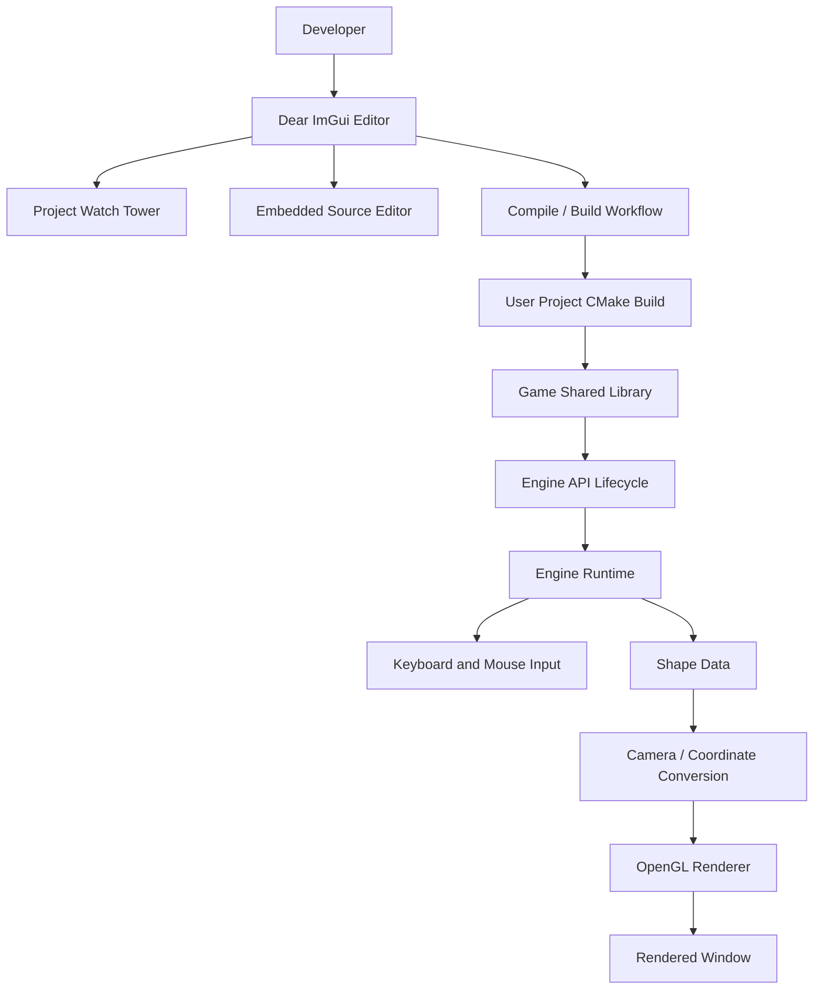

🌌 Lucid Drift
A free-flowing stream of imagination — with the clarity to build your own world.
A native C++ 2D game engine and editor, built to turn code into worlds.

✨ Explore the source · 🐛 Report a bug · 💡 Suggest an idea

[!IMPORTANT]
A note about screenshots: This README uses badges and diagrams for visual structure. Add real screenshots from the current editor to the repository (for example under docs/images/) and link them here once those images are committed. No mock screenshots are presented as real engine output.

Lucid Drift is an experimental, native 2D game engine and editor written in C++. The project brings together an OpenGL-based renderer, a Dear ImGui editor interface, project browsing, CMake-driven game-project builds, and an engine API for running user-written C++ game code.

The goal is to create a development environment where the developer can work with 2D geometry and game logic in C++, inspect project files, build a game module, and run that module through the engine instead of treating rendering, editing, and game code as completely separate tools.
[!WARNING]
Lucid Drift is a work in progress. It is not yet a finished or production-ready game engine. Some systems are implemented, others are actively being developed, and public interfaces or project formats may change. A feature mentioned below should not be interpreted as a guarantee that every edge case is handled or that the feature is stable on every platform.

🧱 Build it.   🎨 Shape it.   💻 Code it.   🌍 Create your world.

🧭 Table of contents
- Project goals
- Feature overview
- Technology stack
- Requirements
- Build the engine
- Run the editor
- Using the editor
- Rendering and coordinate spaces
- Creating a game module
- Engine API lifecycle
- Project structure
- High-level architecture
- Development status and roadmap
- Troubleshooting
- Contributing
- License
📸 Screenshots & visuals
The best way to show Lucid Drift is with real screenshots from the running editor. When you add captures to the repository, keep them in a stable folder such as docs/images/ and use relative links so they work for anyone who clones the project.

Suggested gallery layout:
docs/
└── images/
    ├── editor-overview.png       # Main editor and its panels
    ├── project-watch-tower.png   # Project browser
    ├── shape-editor.png          # Circle / polygon configuration
    └── code-editor.png           # Embedded source editor
Then add the committed screenshots here:

These are suggested filenames, not files that currently exist. Replace them with the actual screenshots and paths before uncommenting the image links. This avoids broken images or misleading mockups in the project README.
🎯 Project goals
Lucid Drift is being developed around a few core ideas:
- C++-first development. Game behavior is intended to be authored in C++, with a small lifecycle API connecting user code to the engine.
- A native editor. The editor is built with Dear ImGui and runs alongside the rendering and project-management systems.
- A deliberately small 2D foundation. Primitive geometry and its rendering pipeline are the current focus, rather than an attempt to immediately provide every subsystem found in a mature commercial engine.
- A clear separation between engine and game code. The engine/editor is built as its own program, while a game project is built separately and, on the Linux loading path, produced as a shared library that the engine can load.
- Incremental development. Rendering, geometry, camera behavior, the editor, input, and the game-module workflow are developed as distinct parts that can evolve over time.
Lucid Drift is primarily a learning and engineering project. Its architecture and supported workflows should be evaluated against the current source, not against the feature set of a mature engine.
🧩 Feature overview
The table below describes the current development areas and deliberately distinguishes active work from stable, completed functionality.
Area	Current scope	Status
2D rendering	OpenGL rendering for primitive geometry	Implemented and evolving
Primitive shapes	Circle, line, and polygon workflows	Implemented and evolving
Polygon geometry	Filled-polygon triangulation, including work on concave polygons	Under active development; validate difficult shapes
Editor UI	Dear ImGui windows, controls, and editor panels	Implemented and evolving
Project browsing	Browse project folders and files and select source files	Implemented and evolving
Source editor	Embedded text editing based on ImGuiColorTextEdit	Integrated and evolving
Code suggestions	Keyword-based suggestions and popup integration	In progress; not a full C++ language server
Build integration	Invoke a CMake build for a user game project	Implemented for the current workflow; configuration-sensitive
Game-module loading	Load a Linux shared library and resolve lifecycle entry points	Implemented for the current Linux path; API may change
Keyboard and mouse input	Engine-level input handling with platform-specific implementation work	Evolving
Camera / coordinate conversion	Keep world-space shape data separate from render-space coordinates	Under active development

This is not a claim that every item is complete, portable, or free of bugs. In particular, robust triangulation for every polygon, stable camera behavior, comprehensive input coverage, and production-quality project/module management should not be assumed without testing the exact revision being used.
What is not promised yet
Do not assume that the current project provides a complete physics engine, audio system, animation framework, texture/asset pipeline, scene serialization format, visual scripting system, or production-ready packaging workflow. These are not presented here as finished features.
🛠️ Technology stack
Technology	Role
C++26	Primary implementation language configured by the project
CMake	Configuration and build-system generation
Ninja	Recommended build generator for the commands in this README
OpenGL 4.6 Core Profile	Rendering API used by the current renderer
GLSL 4.60	Shader language version used by the renderer
GLFW	Window creation, OpenGL context creation, and window/input integration
GLM	Vector and matrix mathematics
Dear ImGui	Editor UI and tooling windows
ImGuiColorTextEdit	Embedded source-editor component, located in the project's third-party code
CMake-built shared libraries / dlopen path	Current Linux game-module build and loading workflow

The root CMake configuration is the authoritative source for the exact dependency setup. Some third-party code may be kept in the repository, while other dependencies may be expected from the host system. If a dependency is missing, consult the CMake error and the relevant CMake files rather than assuming every library is installed or bundled in the same way.
📋 Requirements
Before building, check that your system has:
- A C++ compiler with the C++26 language features required by the current source.
- CMake 4.3 or newer, matching the current minimum version configured by the project.
- Ninja, if using the commands below.
- OpenGL development libraries and a graphics driver that supports an OpenGL 4.6 Core Profile context and GLSL 4.60.
- The GLFW, GLM, and other development dependencies requested by the repository's CMake configuration.
- Git, to clone the repository and inspect changes.
C++26 support depends on the compiler version and on which language features the source uses. A compiler accepting -std=c++2c or -std=c++26 is not, by itself, a guarantee that every feature used by the project is implemented.
Arch Linux example
On Arch Linux, a reasonable starting point for the standard build tools and common graphics/math dependencies is:
sudo pacman -S --needed base-devel git cmake ninja glfw glm mesa libglvnd
This is a starting point, not a verified exhaustive dependency list. Install any additional packages reported as missing by CMake, and check the project's current CMake files for libraries or third-party components that are built from source. Make sure the active GPU driver can create the requested OpenGL context.

Verify the tools before configuring:
git --version
cmake --version
ninja --version
c++ --version
⚙️ Build the engine
Run the commands from the repository root — the directory containing the top-level CMakeLists.txt.
1. Clone the repository
git clone --branch master --single-branch https://github.com/Peyman-Dev-Eng/Lucid_Drift.git
cd Lucid_Drift
If you have already cloned the project, change into that checkout and confirm that you are on the intended branch:
git branch --show-current
git status --short
2. Configure the build
cmake -S . -B BUILD -G Ninja -DCMAKE_BUILD_TYPE=Debug
BUILD is the build directory; it is separate from the source tree. Keeping generated files in this directory makes it easier to clean or reconfigure the build without deleting source files.
3. Compile
cmake --build BUILD --parallel 14
Change 14 to the number of parallel jobs suitable for your machine. If you use a different generator, configure the build accordingly and keep the cmake --build command pointed at the same build directory.
4. Locate the build outputs
The main executable target is named Lucid_Drift. The engine also has a shared-library output named libEngine.so in the current Linux-oriented layout. The precise output locations are controlled by CMake target properties, so inspect the build output instead of assuming every generated file is in the same directory.

For example, find the executable and engine library under the build tree with:
find BUILD -type f \( -name 'Lucid_Drift' -o -name 'libEngine.so' \) -print
If CMake reports a configuration error, resolve that first; compiling cannot succeed until all required packages, include paths, source paths, and compiler features are available.
Reconfigure or rebuild
After changing CMake files or switching revisions, rerun configuration and then rebuild:
cmake -S . -B BUILD -G Ninja -DCMAKE_BUILD_TYPE=Debug
cmake --build BUILD --parallel 14
If the build directory contains stale configuration from a different generator, compiler, or source checkout, create a new build directory rather than mixing configurations. For example, use BUILD-debug or BUILD-clang.
🚀 Run the editor
After the build succeeds, run the Lucid_Drift executable from the path reported by the build system. If the executable is located directly inside BUILD, the command is:
./BUILD/Lucid_Drift
If it is emitted into another configured output directory, use that path instead. Launch the program from a terminal while debugging so that runtime errors and diagnostic output remain visible.

The current renderer requests an OpenGL 4.6 Core Profile context. A system can successfully compile the program and still fail at runtime if the active driver or GPU cannot provide the required context. Verify the actual OpenGL version exposed by the driver if the window or renderer fails during initialization.
🖥️ Using the editor
The editor brings together the engine's project-facing tools and rendering-related controls. Window names and workflows can change as the interface develops; the following are the main areas present in the current development work.
Project browsing
Project Watch Tower is the project/file-browsing subsystem. It is responsible for browsing directories and files and for reporting file selections to the editor. The GUI owns the ImGui window and its presentation; project browsing logic is kept separate from the general window-management responsibilities.

A typical source-editing workflow is:
1. Open or select a project using the current project workflow.
2. Browse its files in the project browser.
3. Select a source file to open it in the embedded editor.
4. Edit and save the file using the editor's available controls.
5. Build the game project using the configured build workflow.
6. Run the game module through the engine when the build and required entry points are available.
The exact project-selection steps and persistence behavior can change between revisions.
Main and settings windows
The ImGui interface contains a main/settings workflow and separate panels for supported tools. Development windows include project management, the console, shape-configuration panels, key-target selection, and exit confirmation. These panels are part of the editor interface rather than separate applications.
Shape configuration
The current shape-oriented workflow includes configuration panels for circles, polygons, and lines. The available properties depend on the shape and on the current revision. Shape editing and rendering behavior are still evolving, so verify the rendered result when testing boundary cases such as very small shapes, large coordinates, or unusual polygon layouts.
Embedded source editor and suggestions
The embedded editor is based on ImGuiColorTextEdit. The project also contains work on a custom keyword-suggestion mechanism intended to propose likely completions from the text being edited.

These suggestions should not be confused with full C++ semantic completion. Correct C++ completion requires understanding scopes, overloads, types, templates, macros, included headers, and the active build configuration; the custom suggestion system is an evolving editor feature rather than a replacement for clangd or another language server.
🎨 Rendering and coordinate spaces
Lucid Drift's current graphics foundation uses GLFW to establish a window and OpenGL context, then renders primitive geometry through its renderer and shaders. The renderer uses a modern OpenGL core context and GLSL 4.60 shaders.
Primitive geometry
- Circles are represented using a configurable set of points and rendered as polygonal geometry. Increasing the point count can make the approximation smoother, at the cost of additional geometry.
- Lines use their own shape/configuration workflow and are sent through the renderer.
- Polygons use vertex data and triangulation for filled geometry. Concave polygons require more care than convex polygons; input validation and triangulation behavior remain important areas to test.
These descriptions refer to the engine's current primitive-rendering direction, not to a guarantee of support for every geometry edge case.
World coordinates and screen coordinates
The intended coordinate model distinguishes world-space shape data from the coordinates used for rendering. A shape should retain its world position; when the camera or viewport changes, the renderer converts that position into the coordinate space required for the current frame. This makes it possible to move the camera without treating every shape's world position as its permanent screen position.

Camera and viewport conversion are under active development. Do not assume that all zoom, scrolling, resizing, or transformation edge cases are already stable. When changing this part of the code, keep the following concepts distinct:
- World space: the logical position of an object in the game world.
- Camera transform: the view offset and zoom used to decide which part of the world is visible.
- Viewport / screen space: the coordinates available to the rendered window.
- Clip space / NDC: the normalized coordinates used by the GPU after the applicable projection transform.
Mixing these spaces is a common source of incorrect placement, scaling, and input hit-testing bugs. Camera-related code should use one clear transformation path and should avoid applying the same offset or zoom twice.
Rendering pipeline at a high level
Shape data (world space)
        |
        v
Camera / viewport transformation
        |
        v
Renderer vertex data
        |
        v
OpenGL buffers and GLSL shaders
        |
        v
Rendered frame
This diagram describes the conceptual flow; it is not a promise that every stage is already implemented as a separate public API.
🕹️ Creating a game module
The engine/editor and a user-created game project are separate build contexts:
- Engine build: compiles the Lucid_Drift application and the engine's own components.
- Game-project build: compiles your project's C++ source into a shared library that the engine can load using its current module-loading workflow.
On the current Linux loading path, the engine expects a shared library whose filename follows the convention:
lib<ProjectName>.so
For example, if the configured project name is TestProject, the expected filename is:
libTestProject.so
The library needs to be created in the build output location searched by the engine. The project name, generated filename, build directory, and engine configuration must agree. A successfully compiled shared library will still fail to load if it is emitted under a different name or into a different directory.
Example lifecycle source file
The current engine API contract uses three C-linkage entry points: BeginPlay, Tick, and EndPlay. Tick receives the frame's delta time as a float.
#include <EngineAPI.h>

extern "C" void BeginPlay()
{
    // Initialize game-specific state.
}

extern "C" void Tick(float deltaTime)
{
    // Update game-specific state using deltaTime.
    (void)deltaTime;
}

extern "C" void EndPlay()
{
    // Release game-specific state.
}
This is the expected entry-point shape, not a complete game project by itself. Your game target must also be configured as a shared library, include the directory containing EngineAPI.h, and place the resulting library where the engine expects to find it.
Build configuration checklist
Before trying to run a module, verify all of the following:
1. The game project's CMake configuration uses the intended project name.
2. The game target is a shared library, not just an executable or static library.
3. The shared-library filename matches lib<ProjectName>.so on Linux.
4. The compiler can find EngineAPI.h through the target's include directories.
5. BeginPlay, Tick(float), and EndPlay are exported with C linkage and exact compatible signatures.
6. The build writes the library into the directory the engine's loader searches.
7. The game library and engine are built for compatible architectures and runtime environments.
Lifecycle responsibilities
Use the lifecycle functions as follows:
- BeginPlay() — initialize state needed when gameplay starts.
- Tick(float deltaTime) — advance game logic for the current frame. Use deltaTime for time-based movement and updates instead of assuming every frame has the same duration.
- EndPlay() — release resources owned by the game module and stop game-specific activity before it is unloaded.
Keep exported signatures exact. A function with a different parameter list is a different symbol and will not satisfy a loader looking for the expected symbol. Avoid allowing C++ exceptions to escape across this C-linkage boundary. Any future changes to the engine API should be checked against the header in the exact revision being built.
[!NOTE]
The shared-library naming and dlopen workflow described here are specific to the current Linux path. Equivalent behavior on Windows or macOS should not be assumed unless that platform's loader and build implementation have been verified in the source.

🗂️ Project structure
The repository is organized around the engine, its runtime systems, the editor, and third-party components. The tree below is a high-level guide to the codebase, not a verbatim dump of every path in the current commit; check the repository browser for exact filenames.
Lucid_Drift/
├── CMakeLists.txt                 # Top-level CMake configuration
├── README.md                      # Project overview and setup guide
├── Main/                          # Main application and engine implementation
│   ├── Core/                      # Core runtime / engine coordination
│   ├── Engine/                    # Engine systems
│   │   ├── System/
│   │   │   └── Input/             # Keyboard and mouse input
│   │   ├── Renderer/              # OpenGL rendering path
│   │   ├── Window/                # Window and graphics-context setup
│   │   └── ...                    # Other engine subsystems
│   ├── GUI/                       # Dear ImGui editor and window logic
│   ├── Compile/                   # User-project build / module loading
│   └── ...                        # Additional engine modules
├── EngineAPI/                     # Public-facing game lifecycle API
├── ThirdParty/                    # External libraries / embedded components
│   └── ImGuiColorTextEdit/        # Embedded source-editor component
└── BUILD/                         # Local generated build output (not source)
What the main areas do
Path / subsystem	Purpose
Main/	Main engine implementation and runtime code.
Main/Engine/	Engine-level systems such as windowing, rendering, input, and geometry-related functionality.
Main/GUI/	Editor windows, controls, project-facing workflows, and ImGui integration.
Main/Compile/	Builds user game projects and coordinates loading of the resulting module.
EngineAPI/	Interface between the engine runtime and user-authored game code. Confirm the exact include path in the current CMake configuration.
ThirdParty/	Third-party dependencies or components used by the project.
ThirdParty/ImGuiColorTextEdit/	Text editor component used for embedded C++ source editing.
BUILD/	Example local build directory. Generated output should normally stay out of version control.

[!TIP]
Want to understand the project quickly? Start with the top-level CMakeLists.txt, then follow the engine entry point and core handler, inspect the GUI setup, and finally trace the renderer and EngineAPI lifecycle. That path gives you a useful overview of how the editor, runtime, and game module connect.

🏗️ High-level architecture
A simplified view of the relationship between the editor, runtime, and user game code is:

This is a conceptual diagram for orientation, not an exact call graph. The source code and CMake targets define the actual ownership, initialization order, and dependencies.
🧪 Development status and roadmap
Lucid Drift is being built incrementally. The areas most relevant to the current architecture include:
- Improving circle, line, and polygon rendering and validating polygon triangulation against concave and degenerate inputs.
- Making camera movement, zoom, viewport dimensions, and world-to-screen conversion behave consistently.
- Improving editor workflows for browsing, editing, compiling, and running user projects.
- Refining keyboard and mouse input handling and the editor's key-selection workflow.
- Developing keyword suggestions while keeping the embedded editor responsive.
- Making build and shared-library loading failures easier to diagnose through clear console output.
This list is a summary of active engineering areas, not a promise of release dates or a guarantee that any item is complete. Check the source and recent commits for the exact state of the current branch.
🩹 Troubleshooting
CMake reports that the version is too old
Check the version selected by your shell:
cmake --version
The current project configuration requires CMake 4.3 or newer. Installing another version is only useful if it is the version actually selected by PATH or by your IDE's configured CMake executable.
The compiler does not support a C++26 feature
Check the compiler path and version used by CMake, not only the compiler installed globally. Configure a fresh build directory if you switch compilers. If a language feature is missing, the source may require a newer compiler than the one selected by your environment.
CMake cannot find a dependency or source file
Read the first relevant CMake error carefully. Confirm that the source path is relative to the CMakeLists.txt file where it is used, and that third-party directories exist at the locations expected by the configuration. Avoid fixing a missing path by adding an arbitrary include directory: include paths and compiled source paths are separate CMake concerns.
The application builds but cannot create an OpenGL context
Verify that the active GPU driver exposes OpenGL 4.6 and supports GLSL 4.60. On hybrid-graphics systems, make sure the application is running with the intended GPU/driver. A successful compile does not guarantee runtime context availability.
A circle or polygon does not render correctly
Check the input geometry before investigating the GPU: point count, coordinates, generated vertex count, triangulation output, and the primitive mode used for drawing. For polygons, validate the vertices and triangulation separately, particularly with concave, self-intersecting, repeated, or nearly collinear points. Not every such input is necessarily supported by the current implementation.
A user game project builds but does not start
Check the actual shared-library filename and location first. On the current Linux path, the expected naming convention is lib<ProjectName>.so. Then verify that the library exports all three expected symbols with C linkage and exact signatures, and that the project name used by the loader matches the CMake target/output filename.
A lifecycle function is not found
Use the exact function name and signature shown in the Engine API lifecycle section. In particular, a missing extern "C" changes the symbol name through C++ name mangling, and a Tick function with a different parameter type does not match Tick(float).
ImGui reports that Render() or EndFrame() was not called
Treat this as an ImGui frame-lifecycle issue. Check that each started frame is completed in the correct order, that ImGui::Render() is called as required by the backend flow, and that multiple code paths do not start or finish the same frame incorrectly. Avoid adding another Render() call blindly; trace the exact begin/frame/render sequence.
The build or editor behaves differently after changing branches
Confirm the current branch and working tree, then reconfigure the correct source/build pair. Old cache values and generated files can preserve settings from another branch or compiler. Use a clean, separate build directory when necessary.

When reporting a bug, include the operating system, compiler and version, CMake version, GPU/OpenGL version if rendering is involved, the exact build command, and the first complete error message or relevant log.
🤝 Contributing
Contributions, bug reports, and focused improvements are welcome. Because the codebase is actively evolving, small, reproducible changes are easier to review than broad changes that combine unrelated systems.

Before submitting a change:
1. Build the current branch and record any pre-existing failures.
2. Keep the change focused on one subsystem where possible.
3. Update the relevant code comments or documentation if an API, build requirement, or workflow changes.
4. Test the affected path manually, especially rendering, polygon geometry, camera transforms, or module loading when those systems are touched.
5. Include the exact steps needed to reproduce a bug or verify a fix.
Please avoid describing a feature as complete merely because its simplest demonstration works. Boundary cases and failure behavior matter for an engine intended to be used by other C++ projects.
📄 License
Check the repository's LICENSE file for the applicable license and reuse terms. Do not assume that every third-party dependency uses the same license as Lucid Drift.
Lucid Drift is a work in progress. Its long-term aim is to provide a clear C++-oriented workflow for creating and running interactive 2D worlds, while keeping the underlying engine systems understandable and extensible.
